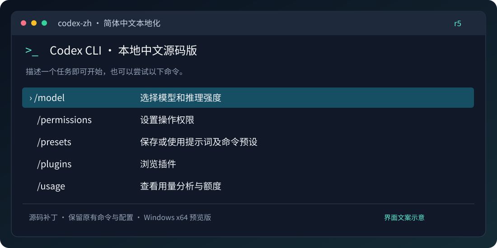

<div align="center">

# Codex CLI 简体中文

**让日常使用的终端界面更容易读懂。**

[](https://github.com/TOM1457998914/codex-cli-zh/actions/workflows/verify.yml)


[下载预览版](https://github.com/TOM1457998914/codex-cli-zh/releases) · [构建说明](docs/BUILDING.md) · [已知缺口](docs/ROADMAP.md) · [参与贡献](CONTRIBUTING.md) · [English](README.en.md)

</div>



这是基于 [OpenAI Codex](https://github.com/openai/codex) 官方源码制作的**非官方简体中文本地化项目**。通过固定版本的源码补丁构建，保留命令名称、配置键、快捷键绑定、协议标识和用户内容。

**当前为 r7 预览版本，汉化仍在进行。** 主要日常菜单已完成多轮检查；命令行帮助与更多低频流程已纳入本轮检查；服务端、第三方库及原始诊断中的部分文字仍保留原文。项目不声称百分之百汉化，也不属于 OpenAI 官方产品。

## 可以直接使用的内容

| 范围 | 本轮工作 |
| --- | --- |
| 恢复会话与预设 | 标题、筛选、排序、归档、空状态、编辑与快捷键提示 |
| 快捷键设置 | 操作名称、分组、未绑定状态、修改流程及冲突提示 |
| 插件与应用 | 列表、搜索、加载、详情、安装与管理提示 |
| 用量与状态 | 用量分析、图表、额度、状态栏和终端标题设置 |
| 日常管理 | MCP、后台服务、技能、导入、代理管理和退出提示 |
| 使用提示 | 44 条中文提示，保留命令与自定义快捷键引用 |
| 命令帮助 | 顶层与子命令的 231 条静态说明、帮助标题和权限模式说明 |
| 中文排版 | 修正宽字符对齐、图表月份、窄窗口换行及截断 |

r7 补齐 CLI 静态帮助、登录、语音、钩子、旁支聊天、目录切换、工具记录和诊断显示中的更多文案，并修复内部标识误译、复制内容、粘贴标签冲突、中文列宽和链接区域等问题。

本地完整 TUI 单元测试 **6052 项通过**，CLI **310 项**，云任务 **24 项**，非交互输出 **64 项**；关闭快照自动更新和失败重试后验证。独立检查覆盖 333 个修改过的生产源文件和 171 个快捷键标识。实际范围、上游跳过项和平台限制见 [验证记录](docs/verification.json)，问题原因见 [排查记录](docs/AUDIT-r7.md)。

## 快速开始

目前提供 Windows x64 预览包，使用 PowerShell 7 安装。

1. 在 [Releases](https://github.com/TOM1457998914/codex-cli-zh/releases) 下载 `codex-cli-zh-v0.169.0-zh.7-windows-x64.zip`。
2. 解压到一个新目录，进入该目录后运行：

```powershell
pwsh -NoProfile -File .\install.ps1
```

3. 重新打开终端，运行：

```powershell
codex-zh
```

启动标题应包含 **「本地中文源码版 r7」**。官方 `codex` 命令保持独立；两个入口使用同一份 Codex 账号、配置与聊天数据。

也可以下载本仓库后，让安装脚本获取指定发布包并校验 SHA-256：

```powershell
pwsh -NoProfile -File .\scripts\Install.ps1 -Version v0.169.0-zh.7
```

只想先验证安装包：

```powershell
pwsh -NoProfile -File .\install.ps1 -VerifyOnly
```

安装位置为 `%LOCALAPPDATA%\Programs\CodexCliZh`。安装脚本会添加当前用户的命令路径，不需要替换系统 PowerShell，也不会覆盖官方 `codex.exe`。

## 从源码构建

仓库包含补丁、词表和构建工具。上游源码在准备阶段获取，避免在这里重复维护完整上游历史。

```powershell
git clone https://github.com/TOM1457998914/codex-cli-zh.git
cd codex-cli-zh
pwsh -NoProfile -File .\scripts\Prepare-Source.ps1
pwsh -NoProfile -File .\scripts\Build-Windows.ps1
```

需要 Git、Rust 1.95.0、Visual Studio C++ Build Tools、Windows SDK、CMake 和 Ninja。完整步骤、V8 校验链以及测试运行方式见 [BUILDING.md](docs/BUILDING.md)。

当前预览包使用 `dev-small` 构建配置，未做发布级性能优化，也不支持直接通过 `codex update` 更新本地中文分支。更新应使用本项目的新发布包；维护者可选择 `-Profile release` 自行构建并重新验证。

## 版本与回退

| 项目 | 固定值 |
| --- | --- |
| 上游版本 | `0.169.0` |
| 上游标签 | `rust-v0.169.0` |
| 上游提交 | `d32063f96c2dff1dc96af839b3952abb6acfeda4` |
| 本地化修订 | `r7` / `v0.169.0-zh.7` |
| 已验证平台 | Windows x64 |

安装器保留已经安装的旧版本。需要回退时，运行旧版本目录内的 `install.ps1`，即可重新选择该版本。查看安装的版本目录：

```powershell
Get-ChildItem "$env:LOCALAPPDATA\Programs\CodexCliZh\versions"
```

卸载本项目安装的版本：

```powershell
pwsh -NoProfile -File .\scripts\Uninstall.ps1
```

卸载器只处理带有本项目安装记录的应用目录，保留个人 `.codex` 数据和官方 Codex。对使用其他脚本安装的旧版本，它会明确退出，不会猜测删除位置。

## 项目结构

```text
patches/       固定上游版本的完整中文源码补丁
locales/       翻译词表与中文使用提示
scripts/       准备源码、校验依赖、构建、打包、安装、卸载
tools/         项目完整性与隐私检查
docs/          构建说明、验证记录和后续工作
version.json   版本、提交、补丁与 V8 校验信息
```

`patches/` 是当前构建的依据，`locales/` 用于追踪和维护译文。编辑词表后，还需要同步对应的 Rust 显示代码并更新源码补丁。源文件中的序列化标识、参数解析和用户输入不能按普通文案替换。

## 反馈与贡献

发现漏译、错译或排版问题，可以 [提交 Issue](https://github.com/TOM1457998914/codex-cli-zh/issues/new/choose)。请提供版本、进入页面的命令、终端宽度和可复现步骤；截图中如有账号或聊天内容，请先遮挡。

欢迎按页面提交小范围改动。请先阅读 [贡献说明](CONTRIBUTING.md) 和 [路线图](docs/ROADMAP.md)。

## 许可证与致谢

上游项目：[OpenAI Codex](https://github.com/openai/codex)。本项目保留其 [Apache-2.0 许可证](LICENSE) 和 [NOTICE](NOTICE)，新增本地化内容同样使用 Apache-2.0。构建时获取的其他依赖沿用各自的许可证。

本项目仅对本地化改动、构建与分发工具进行维护。模型服务、账号权益和上游功能仍由各自提供方管理。
